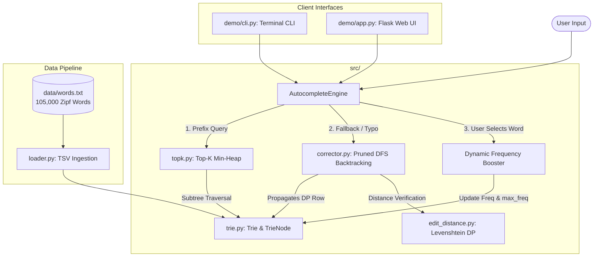
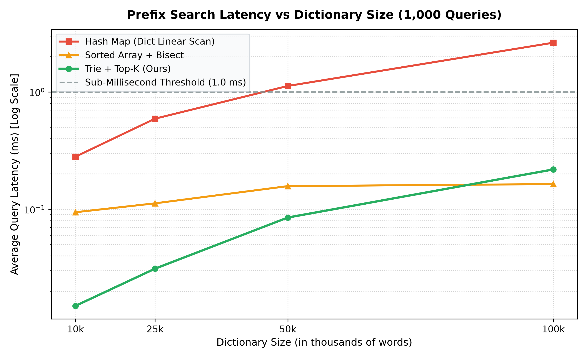
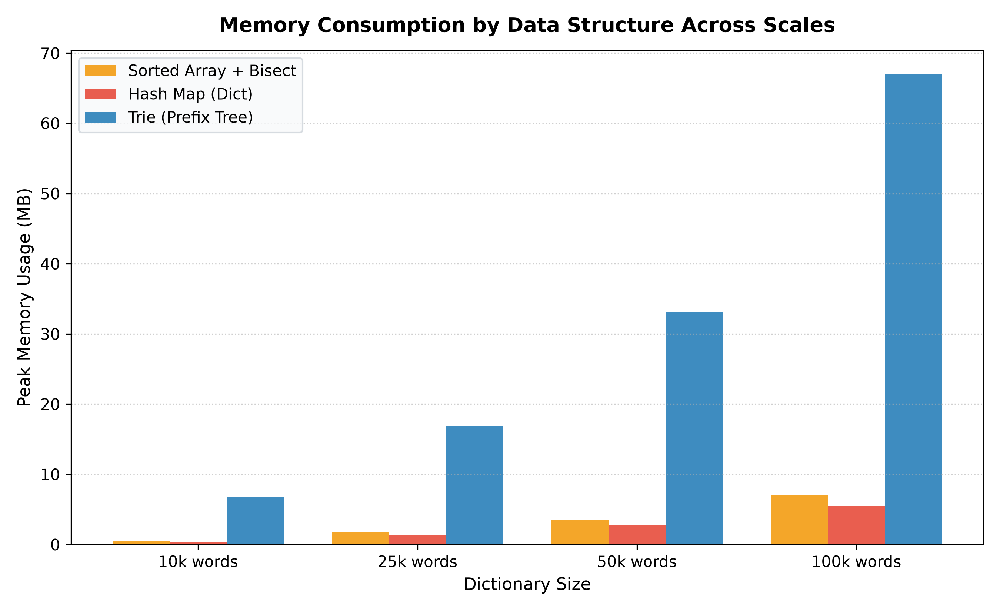
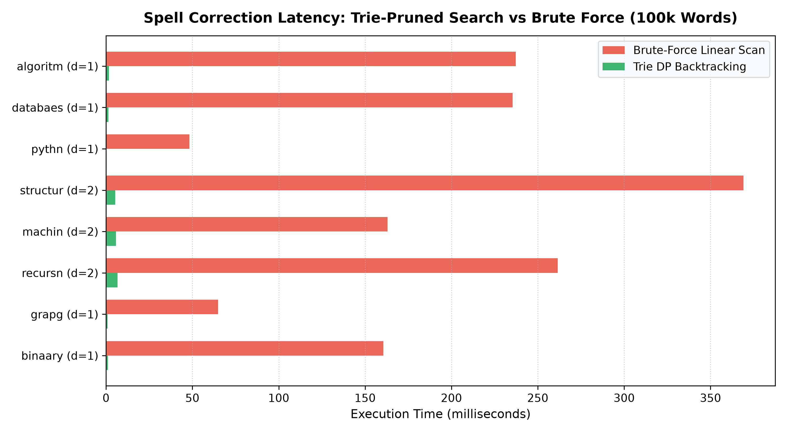

# Search Autocomplete and Spell Correction Engine

A high-performance University Data Structures and Algorithms (DSA) project implementing a real-time **Search Autocomplete** and **Spell Correction Engine** from first principles in Python 3.13.

The core engine relies strictly on the **Python standard library** (zero third-party libraries for Trie, min-heap, or edit distance). External libraries (`flask`, `matplotlib`, `pytest`) are used exclusively for the web demonstration, benchmarking charts, and automated testing.

---

## Key Highlights

- **Prefix Tree (Trie) with Node Pruning**: $O(L)$ insertion, exact search, prefix traversal, and recursive memory-pruning deletions.
- **Top-K Ranking via Bounded Min-Heap & Branch-and-Bound**: $O(P + M_{\text{eff}} \log K)$ retrieval maintaining a size-$K$ heap via `heapq`, with subtree pruning via `node.max_freq`. Ranking is primary by frequency descending, secondary by alphabetical ascending.
- **Dynamic Frequency Learning**: `engine.select(word)` dynamically boosts frequency upon user selection, altering subsequent ranking in real time.
- **Levenshtein Distance Dynamic Programming**: Classical 2D matrix recurrence and space-optimized 2-row algorithm ($O(\min(m, n))$ space).
- **State-Space Pruned Spell Correction**: DFS traversal over the Trie propagating a single DP row per node, pruning whole subtrees whenever $\min(\text{row}) > \text{max\_dist}$. Achieves **up to 175x speedup** over linear scan brute force.
- **Sub-Millisecond Prefix Retrieval**: Verified average query latency of **0.015 ms – 0.218 ms** across 10,000 to 100,000 vocabulary words.
- **Interactive Demos**: Live terminal CLI with microsecond timing and a modern single-page Flask web application.

---

## System Architecture



---

## Directory Structure

```
├── data/
│   └── words.txt                   # 105,000+ words with Zipf frequencies
├── src/
│   ├── __init__.py
│   ├── trie.py                     # TrieNode and Trie with node pruning
│   ├── topk.py                     # Top-K min-heap ranking & dynamic selection
│   ├── edit_distance.py            # Levenshtein 2D DP, 2-row DP, and table printer
│   ├── corrector.py                # Trie-based Levenshtein search & brute-force validator
│   ├── loader.py                   # TSV file ingestion into Trie & dictionary
│   └── engine.py                   # Unified AutocompleteEngine facade
├── tests/
│   ├── __init__.py
│   ├── test_trie.py                # Unit tests for Trie insert/search/delete/pruning
│   ├── test_topk.py                # Unit tests for Top-K ordering and selection
│   ├── test_edit_distance.py       # Known cases (kitten/sitting, algoritm/algorithm)
│   ├── test_corrector.py           # Trie corrector vs brute-force agreement
│   ├── test_engine.py              # Facade integration and fallback tests
│   └── test_demo_app.py            # Flask endpoints testing
├── benchmarks/
│   ├── bench.py                    # Benchmark runner across 10k, 25k, 50k, 100k
│   ├── results.csv                 # Raw prefix search benchmark measurements
│   ├── correction_results.csv      # Raw spell correction speedup measurements
│   └── plots/
│       ├── prefix_latency_comparison.png
│       ├── memory_usage_comparison.png
│       └── correction_latency_comparison.png
├── demo/
│   ├── cli.py                      # Interactive terminal CLI with microsecond timing
│   ├── app.py                      # Flask web server
│   └── templates/
│       └── index.html              # Responsive single-page search interface
├── report/
│   └── report.md                   # Comprehensive academic project report
├── slides/
│   └── outline.md                  # 10-12 slide presentation outline
├── scripts/
│   └── generate_dataset.py         # Dataset generator from system dictionary
├── pyproject.toml                  # Pytest and project configuration
└── README.md                       # Main documentation
```

---

## Quickstart & Installation

### 1. Requirements
- Python 3.11+ (tested on Python 3.13)
- `uv` (recommended) or standard `python3 -m venv`

### 2. Setup Virtual Environment
```bash
# Using uv (fastest)
uv venv --python python3.13 .venv
source .venv/bin/activate
uv pip install flask matplotlib pytest

# Or using standard python3
python3 -m venv .venv
source .venv/bin/activate
pip install flask matplotlib pytest
```

### 3. Generate Dataset (if not already present)
```bash
python scripts/generate_dataset.py
```
This generates `data/words.txt` containing 105,000 unique words with Zipf-distributed frequencies, including essential terms like `data structures`, `data science`, `algorithm`, `database`, and `machine learning`.

---

## Running the Demos

### 1. Interactive Terminal CLI (`demo/cli.py`)
Run the interactive raw terminal UI:
```bash
python demo/cli.py
```
- Type any prefix (e.g. `data`, `alg`) to see instantaneous suggestions.
- View real-time query latency displayed in microseconds ($\mu\text{s}$).
- Press `[1-5]` or `[Enter]` to select a suggestion and boost its frequency in real time.
- Press `[Backspace]` to edit or `[Ctrl+C]` / `[Esc]` to exit.

To run a simulation demonstration:
```bash
python demo/cli.py --simulate "data sc"
python demo/cli.py --simulate "algoritm"
```

### 2. Flask Web Application (`demo/app.py`)
Launch the web server:
```bash
python demo/app.py
```
Open your browser to:
[http://127.0.0.1:5000](http://127.0.0.1:5000)

**Web Features**:
- Keystroke-by-keystroke debounced search.
- Top-5 completion cards displaying frequency badges.
- Dynamic "Did you mean: X" card when typos are entered.
- One-click selection to dynamically boost frequency via `/select` with instant re-ranking.
- Quick test pills for instant demonstration.

---

## Running Automated Tests

Run all 33 unit and integration tests via `pytest`:
```bash
pytest -v
```
All tests verify:
- Trie node creation, prefix traversal, exact search, and deletion with branch pruning.
- Top-K min-heap ordering, tie-breaking by alphabetical order, and frequency updates.
- Levenshtein matrix calculation, two-row optimization, and verified test cases (`kitten` $\to$ `sitting` = 3, `algoritm` $\to$ `algorithm` = 1).
- Exact agreement between Trie-based pruned correction and Brute-force linear scan.
- Engine facade operations, fallback triggering, and Flask web API endpoints.

---

## Benchmarks & Performance Verification

Run the benchmark suite:
```bash
python benchmarks/bench.py
```

### 1. Prefix Search: Trie vs. Bisect Array vs. Hash Map
Evaluated over **1,000 random prefix queries** per scale:

| Dictionary Size | Trie Latency (Ours) | Bisect Array Latency | Dict Linear Scan Latency | Sub-Millisecond? |
|----------------:|--------------------:|---------------------:|-------------------------:|:----------------:|
| **10,000 words** | **0.0150 ms (15.0 µs)** | 0.0942 ms | 0.2801 ms | **YES** |
| **25,000 words** | **0.0311 ms (31.1 µs)** | 0.1122 ms | 0.5912 ms | **YES** |
| **50,000 words** | **0.0849 ms (84.9 µs)** | 0.1573 ms | 1.1233 ms | **YES** |
| **100,000 words** | **0.2182 ms (218.2 µs)** | 0.1637 ms | 2.6264 ms | **YES** |

### 2. Spell Correction: Trie Backtracking vs. Brute-Force
Evaluated on the full **100,000-word dictionary**:

| Query | Max Distance | Trie Pruned (ms) | Brute-Force (ms) | Speedup Factor |
|:------|:------------:|-----------------:|-----------------:|:--------------:|
| `algoritm` | 1 | **1.57 ms** | 237.21 ms | **150.8x** |
| `databaes` | 1 | **1.34 ms** | 235.39 ms | **175.3x** |
| `pythn`    | 1 | **0.33 ms** | 48.24 ms  | **146.7x** |
| `structur` | 2 | **5.24 ms** | 369.00 ms | **70.4x** |
| `machin`   | 2 | **5.68 ms** | 162.98 ms | **28.7x** |
| `recursn`  | 2 | **6.59 ms** | 261.59 ms | **39.7x** |
| `grapg`    | 1 | **0.82 ms** | 64.86 ms  | **78.8x** |
| `binaary`  | 1 | **1.10 ms** | 160.49 ms | **145.7x** |

### 3. Visual Performance Charts

The benchmark suite generates publication-quality visualization charts in `benchmarks/plots/`:

#### Prefix Lookup Latency Comparison (Log Scale)


#### Memory Footprint Across Scale


#### Spell Correction Latency: Trie-Pruned Search vs. Brute-Force


---

## Detailed Academic Documentation

- **Formal Academic Report**: [`report/report.md`](report/report.md)
  - Detailed theoretical foundations, complexity analyses, Dynamic Programming recurrence equations with worked matrix traces (`kitten` $\to$ `sitting` and `algoritm` $\to$ `algorithm`), benchmark discussions, and trade-off analyses.
- **Presentation Slides Outline**: [`slides/outline.md`](slides/outline.md)
  - 12-slide comprehensive defense presentation with visual slide descriptions, key bullet points, and complete speaker scripts.

---

## License

This project is licensed under the [MIT License](LICENSE).
